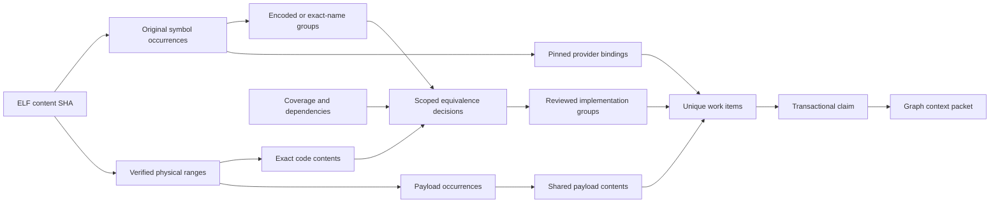

# ELF equivalence and unique work

The native graph, code context graph, readiness registry and unique-work index
have separate lifecycles. `dedup_index.py` imports **into a new derived SQLite
file**, never into the canonical readiness database. Earlier native and dedup
indexes remain available. `dedup_schema.sql` is the explicit v1 migration from
an absent derived schema; there is no implicit readiness migration.

Four independent concepts are stored: original catalog occurrences, encoded
signature groups, exact code/data content groups, and reviewed shared portable
implementations. Exact bytes include literal pools and the full original extent.
Name correspondences remain non-execution relationships. Original return types,
layout, ARM ABI and readiness are never inferred from these groups.

```sh
uc-library/.venv/bin/python dependency-graph/dedup_index.py import --out temp/recovery-work/dependency-graph/UNIQUE_DEDUP
uc-library/.venv/bin/python dependency-graph/dedup_index.py report --db temp/recovery-work/dependency-graph/UNIQUE_DEDUP/dedup.sqlite
uc-library/.venv/bin/python dependency-graph/dedup_index.py publish --db temp/recovery-work/dependency-graph/UNIQUE_DEDUP/dedup.sqlite
```

A repeated import into the same complete generation is idempotent. A changed
native generation, policy/schema or producer requires a new output directory.
Failed imports are retained and cannot be published. Publication refuses to
abandon an active claim in the previous index. Old completed results remain
hash-bound historical results; changed generations require explicit revalidation.

`binary_artifacts` uses ELF content SHA-256. `binary_releases` separates paths,
versions and roles. `symbol_occurrences` retains anchors, aliases, exact names
and original ranges; multiple occurrences may reference one physical range.
Signature keys include the ABI/mangling context. Code keys include machine
context, ARM/Thumb mode, full size and hash. Unknown extents have no content key.
NOBITS has storage/size metadata and no fictional file-byte digest.

Named data with an ELF-symbol extent is independently verified against the full
ELF range and stored once under `objects/SHA256`. Every physical occurrence
retains its extent evidence. Anonymous 256-byte previews do not enter payload
content groups. Containers, compressed/expanded bodies and typed interpretations
are separate: no automatic decoding or transformation equivalence is asserted.
The transformation table requires explicit evidence for future extractors.

Automatic implementation comparison is deliberately conservative. Dependencies
retain instruction-relative sites and full payload identities. Unknown indirect
calls, relocations, partial instruction coverage and unresolved memory/object
semantics block automatic joining. Callee-name equality never establishes callee
implementation equality. Calls, including recursive components, remain blocked
until explicitly reviewed; the evaluator does not recursively hash callees or
allow cycles to verify themselves. Different observed dependencies produce a
negative decision and separate jobs. Unknown equal-byte groups get one research
job to resolve equivalence before reconstruction.

Every decision is append-only and has a scope, producer digest, policy,
generation, evidence and revision. Review with `review --manifest FILE` requires
an exact generation/expected revision, all members, reasons and freshly checked
path/SHA evidence. A verified implementation additionally requires explicit
machine/range/interface/call/data/indirect/coverage review and per-occurrence
domains. This is an evidence-backed operator attestation, not an automatic proof
that a JSON flag is true. Reviews overlapping live work record a conflict and
preserve owners/results. Decisions do not modify readiness.

`plan --task ENRICHED_TASK` prints the unique work. `prepare` uses the same planner
before source refresh or Docker selection and obtains a claim using `BEGIN
IMMEDIATE`. It expands targets to every covered original, so a representative
never hides worse context coverage. One packet covers one unique work item;
split independent work into multiple task files. External providers produce
binding/adapter work and reject firmware reconstruction. A target with an
existing canonical C++ result cannot silently start reconstruction again.

Claims bind owner, packet path, native/dedup generation and decision revision.
The same work requested again returns the original owner/claim; it cannot be
claimed using different filenames. Prepare failure retains the claim for explicit
inspection. There is no expiry or automatic stealing. Release with
`release --claim ID --manifest FILE` requires owner/reason and recorded checks of
live process/agent and resumable state. An observation timeout is insufficient.

`context.json` contains `work_binding`: work kind/id, representative, every
covered occurrence, equivalence decision/revision/scope, unique payloads,
excluded duplicates and external provider bindings. `TASK.md` exposes the same
contract. Validation/dispatch checks the active generation and claim again.
`batch-dispatch` rejects overlap in unique work even when filenames differ.
Old packets without this binding must be prepared again. Existing nonempty-body
and source/readiness/formatting/integration gates remain mandatory.

`complete --claim ID --manifest FILE` records a derived result only: common
checks, fresh evidence references, and an individual ELF/name/range digest,
compiled interface check and bounded behavior domain for **every** occurrence.
It never promotes a group in readiness. Readiness admission still uses the
canonical guarded merger and its independent original-identity checks.

No reconstruction worker is launched by import, planning, review or tests.

An unmangled C/ELF name is recorded as exact-name correspondence with
`encoded_signature_equal=0`: it does not encode a parameter list. These
candidates need explicit interface/common-helper review. The automatic rule is
restricted to a closed register-arithmetic subset; PC/SP operations, immediates,
loads/stores and arbitrary dispatch are not silently treated as fully resolved.
Unknown function extents get `establish_extent` work and a blocked range decision.

Optional `import --release-manifest PATH` (repeatable) adds release provenance
for an existing ELF without duplicating the artifact. Each JSON has
`elf_sha256`, `firmware_version`, `role`, `original_path`; the path must contain
exactly those ELF bytes. Its manifest digest is part of the derived generation.
Current imports already retain both original catalog roles/versions. Ordinary
work assignments do not invalidate it; the known canonical C++ identity set is
an import input so rebuilding after new admissions can route existing results.

The importer extracts complete named payloads itself. These extraction jobs are
already completed and point to the verified shared content object and all its
original extents. They do not need agent extraction. Missing/corrupt shared
objects block selection/reuse instead of silently issuing another job.
Payloads needed by a function include object path, full size and full digest in
its work binding and selected-file guard, rather than a preview-only identifier.

When comparing compiler input dictionaries, normalize physical paths before
checking their hashes. Aliases containing `../` do not imply a changed file;
conflicting hashes of aliases still fail. The recovery evidence records reused
compiler observations and their original producers separately from new replay.

Inspect the model with ordinary SQL (bind `?` parameters):

```sql
-- All originals of an exact encoded name; no name normalization.
SELECT o.*, r.content_sha256, r.instruction_mode
FROM symbol_occurrences o LEFT JOIN binary_ranges r ON r.id=o.range_id
WHERE o.original_mangled=? ORDER BY o.elf_sha256,o.original_address;

-- Why a suspected duplicate is not yet shared work.
SELECT d.status,d.verification_scope,d.reason,d.revision,d.evidence_refs
FROM equivalence_decisions d WHERE d.subject_id=? ORDER BY d.revision;

-- Actual active owner, independent of filenames and original aliases.
SELECT w.work_kind,c.owner,c.packet_path,c.created_at
FROM reconstruction_work_items w JOIN work_claims c ON c.work_item_id=w.id
WHERE w.id=? AND c.state='active';
```

`external_providers` stores pin/repository/policy metadata once; occurrences
reference it with an FK. The packet includes that provider metadata together
with each original's scoped binding. A Core data symbol can participate in a
raw payload extraction and a source-binding job: these have distinct purposes;
provider planning chooses the binding job, rather than treating this as two
competing firmware reconstructions.

The report distinguishes original occurrences, all exact-name groups and
mangled encoded-name groups (including named data), code contents and physical
ranges. `excluded_duplicate_jobs` counts verified shared implementation work;
`deferred_candidate_duplicates` is only comparison work held back, not a claim
of proven equivalence or saved reconstruction. Payload extraction counts use
full physical payload occurrences, not the number of aliases or preview paths.


