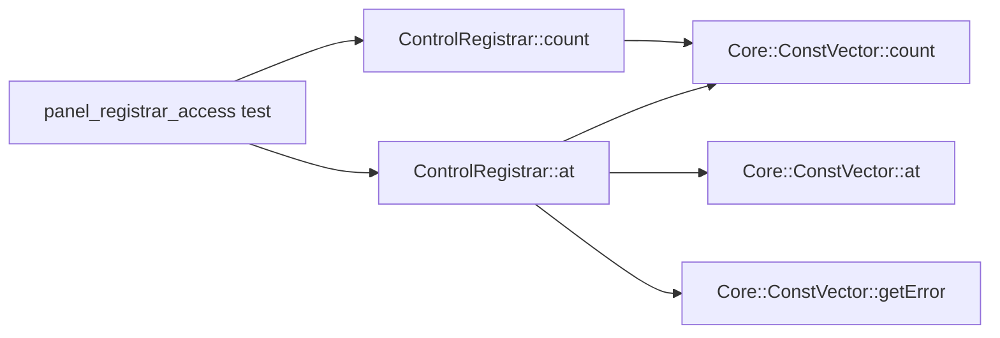

# Полный доступный source/build graph: результат

Во все три БД загружен один полный корпус выбранной Linux-конфигурации:

- **551 185 узлов, 6 651 932 ребра**; счётчики каждого типа совпали.
- **625 TU**: 574 app/test и 51 реальной source-сборки CCL.
- **51 137 original catalog anchors**, включая разные адреса/диапазоны одинаковых
  имён; 119 групп ELF+name имеют несколько anchors. Они не схлопнуты.
- 322 CTest-команды, их явные file arguments, code/type/data references,
  compiler aliases и validation links. Original ready/pending registry не менялся.

Это весь извлечённый корпус доступной активной сборки, а не искусственная выборка.
Это **не полный runtime-граф всех функций исходной прошивки**. Каталог
невосстановленных symbols не содержит автоматически восстановленных вызовов.
Отсутствие source mapping означает неизвестность, не независимость.

GCC source replay прошёл для всех625 TU. Clang: 623 clean + 2 явно отмеченных
recovery AST для GCC-валидной singleton specialization. CCL извлечён из pinned
официального source; Core binary decompilation не применялась. Косвенные и
виртуальные dispatch boundaries сохранены отдельно. Pointer/alias analysis не
выполнялся. Native GCC graph дополнительно покрывает implicit ctor/dtor calls,
которые нельзя считать полными по одним явным CALL_EXPR.

## Последний кейс: достаточны ли 15 записей

**15 — не полный пакет контекста.** Это production-TU impact заголовка:
12 app-методов / 15 per-ELF записей. Для двух выбранных getter-ов проверен другой
вопрос: непосредственные вызовы, их замыкание, типы/данные, вызывающий код и fixture.

| Необходимая часть | Результат |
| --- | ---: |
| Целевые методы / original records | 2 / 4 |
| Прямые связи вызовов из них | 4 |
| Уникальные вызываемые CCL methods | 3 |
| Функции в исходящем замыкании, включая цели | **5** |
| Типы / элементы данных в reading context | **6 / 6** |
| Всего узлов call/type/data context | **17** |
| Прямой caller и все обнаруженные ссылки на цели | **один test main** |
| Связанный тест / fixture | **1 / 1** |
| Source paths / уникальные по bytes source files | **7 / 6** |
| Неразрешённые calls в выбранном контексте | **0** |

17 узлов — функции, типы и данные, а не 17 записей firmware registry; сравнивать их
с 464 per-ELF записями как одну метрику нельзя. Дополнительных app-callees за
пределами прежних15 не найдено, но были нужны Core vector source, state adapter,
ControlGroup declaration, test source и fixture. Adapter уже был в старом
read-on-demand, поэтому не все эти paths являются вновь обнаруженными.

Clang и GCC независимо дали одинаковые четыре target call edges. Проверка всех
574 готовых app/test объектов через nm обнаружила references только из
panel_registrar_access_tests.cpp; расширенный source/compiler graph всех625 TU
не добавил другого caller/address reference. SQLite, Neo4j и Memgraph вернули
одинаковые точные IDs для всех проверенных запросов. Существующий Linux CTest
panel_registrar_access прошёл на2048 fixture cases.

Новый handoff: `runs/full-01/agent-context.md`. Пять нужных function bodies дают
**24 строки существующего source**, с полными original identities, ссылками на
state/caller/fixture и dedicated behavior proof. Это начальный пакет для чтения,
не разрешение убрать validation gates и не измеренное ускорение полного цикла.

## Скорость: короткий справочный замер

Три чередующихся повтора, медианы; Bolt roundtrips включены, disk-cold/high-load
не заявляются. Все результаты совпали. Миллисекунды не определяют выбор.

| Вопрос / метод | SQLite, ms | Neo4j, ms | Memgraph, ms |
| --- | ---: | ---: | ---: |
| callees / count | 0.104 | 1.148 | 0.588 |
| callers / count | 0.053 | 0.805 | 0.510 |
| tests / count | 0.056 | 0.786 | 0.515 |
| call_closure / count | 0.084 | 1.478 | 0.970 |
| reading_context / count | 0.136 | 2.564 | 1.673 |
| callees / at | 0.132 | 1.515 | 0.485 |
| callers / at | 0.054 | 1.334 | 0.415 |
| tests / at | 0.064 | 0.974 | 0.548 |
| call_closure / at | 0.162 | 2.093 | 1.217 |
| reading_context / at | 2.732 | 2.964 | 2.008 |

## Сложность запросов и поддержки

| Задача | SQLite | Neo4j / Memgraph |
| --- | --- | --- |
| Callees, callers, references, source files | Простой SELECT по typed edges | Простой typed path; читается непосредственно |
| Test → TU → caller → target | Три alias таблицы edges, два JOIN | Три явные связи в Cypher; понятнее для исследования |
| Рекурсивный обход с циклами | Один recursive CTE с UNION | Переносимый node-global BFS в Python + batched Cypher шаг |
| Новая code relation | Обновить общую policy tuple и тест | Та же policy, Cypher строится тем же factory |
| Индексы/constraints | Уже используем SQLite, нет второго сервиса | У Memgraph constraint требует отдельного индекса; init различается |
| Версии/импорт/свежесть | Один файл-проекция и существующий registry | Docker service + projection/import state, version/digest и parity checks |

**Cypher не всегда уменьшает весь поддерживаемый код:** безопасная переносимая
рекурсия здесь использует дополнительный BFS helper. Перечисление всех путей
не подменяет reachability. Native APOC/BFS может сократить запрос, но добавит
backend-specific код и тесты. Он в этих измерениях не использовался.

Весь рабочий query catalog находится в `full_queries.py` и
`runs/full-01/query-catalog.json`, включая оба recursive helpers. На этих вопросах
Cypher для Neo4j и Memgraph **одинаковый**. Доказанного различия стоимости
поддержки запросов между ними пока нет.

Практический выбор: SQLite проще эксплуатировать рядом с действующим реестром;
Cypher удобнее для новых исследовательских multi-hop вопросов. При текущей
скорости выбирать по latency оснований нет. Главная стоимость поддержки —
корректный extractor, compile-context identities, source freshness и явная
неопределённость, а не синтаксис СУБД.

Не следует пересобирать весь корпус на каждую маленькую задачу. Эксперимент
сохраняет его как индекс. Дизайн incremental refresh/active generations остаётся
следующим отдельным решением; production schema/process и admission не изменены.
