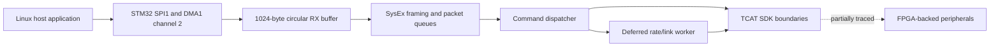

# nimh-stm32-dice — mixer-13731

Human entry point for architecture, findings and remaining work. The directory names the containing host release; it does not establish the embedded firmware version.

## Architecture

The NIMH AVB card contains an STM32F103ZET6 Cortex-M3 and a Spartan-6 FPGA.
Together they implement the logical DICE control/peripheral role. This is a functional
architecture description, not a claim of identical internals to an integrated DICE chip.
The STM32 image has an eCos runtime, TCAT SDK layers and application command handlers.

## Architectural patterns

- Follow application → SDK/DAL → HAL/peripheral boundaries from the local TCAT documentation.
- Separate immediate command acceptance from deferred completion. An ACK does not prove clock lock.
- Treat DMA production, framing, queue publication, dequeue and release as distinct stages.
- Match RTOS/library source before manually reconstructing equivalent runtime code.
- Use architecture patterns from documentation; no direct CS18/RM DICE binary mapping is used here.

## Established findings

| Area | Finding | Scope |
|---|---|---|
| Startup | Flash base `0x08000000`; initial SP `0x20010000`; VTOR moved to SRAM `0x20000000` | Bounded native reset replay; no complete boot |
| Runtime | eCos/TCAT family, 124 CLI records, 24 SDK source-path strings | Exact vendor revision unresolved |
| Versions | Application banner `1.5.5.0`; SDK banner `1.0.0.0 local beta` | Neither is an eCos release identifier |
| Host commands | Rate/link `0x11`, clock source `0x28`, routing `0x16` | 27 host packet-construction cases; modeled transport boundaries |
| Dispatcher | Command decoding, ACKs and selected SDK calls | 222 dispatcher and 12 deferred-consumer cases |
| Receive path | SPI1 → DMA1 channel 2 → buffer at `0x2000cd14` → parser → queue | 20 framing/queue, 3 alternate-queue and 4 receive-to-dispatch cases |
| FPGA-facing access | Mixer callback writes `0x60005204` | 216 native replay cases against RAM-backed register page |

## Open questions

- Exact eCos/TCAT source revision and original embedded declarations/function boundaries.
- Deferred clock/rate transition completion, error propagation and lock confirmation.
- Physical DMA/interrupt behavior, scheduler concurrency and overrun timing.
- Full SDK-to-FPGA interface ownership, register semantics and board signal assignments.
- Hardware interoperability and audio behavior; no hardware validation has been performed.

## Reports and evidence

- [Architecture, runtime and command-path report](analysis/command-paths.md)
- [SPI/DMA receive report](analysis/receive-path.md)
- [Memory layout](memory-layout/README.md)
- [Runtime identification](runtime-identification/README.md)
- [Command-map proof](../../../evidence/mixer-13731/nimh-stm32-dice/jobs/command-map-01/validation.json)
- [Receive replay and explicit boundary models](../../../evidence/mixer-13731/nimh-stm32-dice/jobs/spi-rx-02/replay.json)
- [Receive validation proof](../../../evidence/mixer-13731/nimh-stm32-dice/jobs/spi-rx-02/validation.json)
- [Local TCAT architecture guide](<../../../../doc/DICE_III_User_Guide/TCD30xx - Firmware Development.pdf>)
- [Paired FPGA component](../nimh-fpga-dice/README.md)

## Firmware and identity

[Component manifest](manifest.json) records identities and validation limits.

- [mixer-analysis / _ZL13nimh_arm_code.bin](firmware/mixer-analysis/_ZL13nimh_arm_code.bin)
- [RM16AI_Rack_13731 / _ZL13nimh_arm_code.bin](firmware/RM16AI_Rack_13731/_ZL13nimh_arm_code.bin)
- [RML16AI_Rack_13731 / _ZL13nimh_arm_code.bin](firmware/RML16AI_Rack_13731/_ZL13nimh_arm_code.bin)
- [RML32AI_Rack_13731 / _ZL13nimh_arm_code.bin](firmware/RML32AI_Rack_13731/_ZL13nimh_arm_code.bin)

[All components and releases](../../../README.md)
