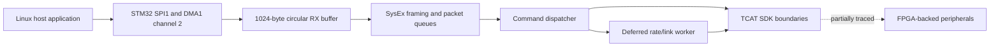

# nimh-stm32-dice: hardware knowledge

Canonical component description, independent of the release used to extract software. Physical board revisions remain separate identities when evidence shows a difference.

## Architecture and patterns

The NIMH AVB card contains an STM32F103ZET6 Cortex-M3 and a Spartan-6 FPGA.
Together they implement the logical DICE control/peripheral role. This is a functional
architecture description, not a claim of identical internals to an integrated DICE chip.
The STM32 image has an eCos runtime, TCAT SDK layers and application command handlers.

## Architectural patterns

- Follow application → SDK/DAL → HAL/peripheral boundaries from the local TCAT documentation.
- Separate immediate command acceptance from deferred completion. An ACK does not prove clock lock.
- Treat DMA production, framing, queue publication, dequeue and release as distinct stages.
- Match RTOS/library source before manually reconstructing equivalent runtime code.
- Use architecture patterns from documentation; no direct CS18/RM DICE binary mapping is used here.

The command and receive paths below describe observations from one software image; they constrain the hardware model without establishing all board behavior.

## Findings and their scope

- Board/photo evidence identifies STM32F103ZET6 and board marking `400-XMEN-NIMH-C`.
- Software observation: mixer-13731 NIMH code programs SPI1 data register `0x4001300c`, DMA1 channel 2 and a 1,024-byte receive buffer at `0x2000cd14`. Native setup and parsing were replayed with RAM-backed registers and modeled scheduling.
- Software observation: a native mixer-control callback writes external address `0x60005204`. The complete bus/register implementation and physical wiring remain unresolved.
- eCos, TCAT SDK banners, queue layout and command opcodes are software properties. They are evidence about interfaces, not permanent attributes of the MCU silicon.

A firmware release does not define a new hardware component. Software-derived observations retain their image identity and tested domain; they are not silently generalized across versions or physical board revisions.

## Open questions

- Exact eCos/TCAT source revision and original embedded declarations/function boundaries.
- Deferred clock/rate transition completion, error propagation and lock confirmation.
- Physical DMA/interrupt behavior, scheduler concurrency and overrun timing.
- Full SDK-to-FPGA interface ownership, register semantics and board signal assignments.
- Hardware interoperability and audio behavior; no hardware validation has been performed.

## Reports and evidence

- [Architecture and extraction report](<../../shared/extraction/embedded-mcu-01/REPORT.md>)
- [Command and SDK architecture](<../../artifacts/mixer-13731/nimh-stm32-dice/analysis/command-paths.md>)
- [SPI/DMA receive findings](<../../artifacts/mixer-13731/nimh-stm32-dice/analysis/receive-path.md>)
- [Command-map validation](<../../evidence/mixer-13731/nimh-stm32-dice/jobs/command-map-01/validation.json>)
- [Receive-path evidence](<../../evidence/mixer-13731/nimh-stm32-dice/jobs/spi-rx-02/replay.json>)
- [TCAT architecture documentation](<../../../doc/DICE_III_User_Guide/TCD30xx - Firmware Development.pdf>)

## Software extraction points

- [mixer-13731](<../../artifacts/mixer-13731/nimh-stm32-dice/README.md>)
- [mixer-6184](<../../artifacts/mixer-6184/nimh-stm32-dice/README.md>)
- [mixer-6439](<../../artifacts/mixer-6439/nimh-stm32-dice/README.md>)
- [mixer-7784](<../../artifacts/mixer-7784/nimh-stm32-dice/README.md>)
- [mixer-8591](<../../artifacts/mixer-8591/nimh-stm32-dice/README.md>)
- [mixer-9244](<../../artifacts/mixer-9244/nimh-stm32-dice/README.md>)

[How discoveries update hardware knowledge](../README.md#updating-the-hardware-model)
