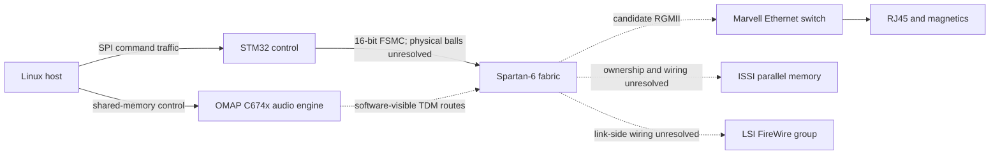

# NIMH AVB card: system architecture

Canonical hardware knowledge independent of the software release used to observe it.

## Physical inventory

These are recorded photograph observations, bound by the photo manifest, not newly measured continuity.

| Part / marking | Role / evidence | Unresolved |
|---|---|---|
| `400-XMEN-NIMH-C` / `400-XMEN-NIMH` | Board markings across the photographed material | Exact revision equivalence and serial applicability |
| STM32F103ZET6 | Cortex-M3 control MCU | Full package-pin/connector mapping |
| XC6SLX45 CSG324 `-2C` | Spartan-6 FPGA; IDCODE `0x04008093` corroborates die family | IDCODE alone does not encode package/speed |
| ISSI IS66WV51216DBLL-55TLI | 512K × 16 parallel pseudo-SRAM | MCU/FPGA sharing and address/data permutation |
| Marvell 88E6240, Pulse magnetics, RJ45 | Ethernet switch/connector group | Port routing, management nets and straps |
| LSI L-FW842-07, two FireWire connectors | FireWire-side group; PHY role inferred from topology/device family | Link-side signals and FPGA balls |
| Long board-to-board connector | Host/control/audio interface candidate | Pinout, direction and signal names |

Separate resonator/oscillator components are visible near the switch and LSI device; frequencies and FPGA clock-input assignments are not established from adjacency.

## Functional partition

STM32 plus FPGA implements the logical DICE role. Firmware-backed register interfaces support AVB, Ethernet/PTP, audio routing, serial audio and clock/HPLL control. This does not establish an identical integrated-DICE implementation. Main mixer dynamics/effects execute on the OMAP DSP; NOAA-subsystem GEQ takes a separate control/routing path.

Dashed connections show hypotheses or software-visible boundaries, not a measured electrical schematic.

## Recovered interface map

Software observations below are from SHA-bound mixer-13731 NIMH firmware. Addresses describe its programmed interface, not a claim of a universal DICE map.

| Interface | Observed address / structure | Evidence scope |
|---|---|---|
| External control | `0x6000xxxx` | Native loads/stores and static FSMC setup |
| External tables/buffers | `0x6400xxxx` | Native register/table references |
| AVB listeners | `0x60000c00 + id*0x20`, id 0..3 | Four addressable banks; not four active streams |
| AVB talkers | `0x60001200 + id*0x20`, id 0..3 | Four addressable banks; capacity/activity unresolved |
| Ethernet/RTC | `0x60004000` | MAC config `+0x300`; RTC snapshot `+0x0c/+0x10/+0x14` |
| PTP | Same base, RX `+0x80`, TX `+0x100` | Relative register layout corroborated by DICE manuals |
| Router | Setup `0x60005000`; table `0x64004000` | Code-backed reads and diagnostic field extraction |
| Clock selection | `0x60005104`, `0x60005108`, `0x60005110` | Router clock, WC/EC and HPLL selectors |
| Mixer coefficient | `0x60005204` | 216 bounded native register-write replay cases |
| Serial audio / InS | `0x60005640`, `0x60005644`, `0x60005648` | Code-backed indexed clock register table |
| HPLL | Initial pointer `0x60006000` | Reference/divider/bandwidth/phase/lock diagnostics |

## Patterns and corrections

Read peripheral-register accesses separately from diagnostics: `PTP HW STATUS` reads a software statistics array at `0x2000dd20`, not a hardware register block. A DICE ETH manual absolute-base typo is not copied into the NIMH map; verified relative offsets and native NIMH addresses take precedence.

The early photo study left FSMC use unknown. Later static startup/code establishes configured 16-bit FSMC use, while physical FPGA ball mapping remains unknown. This is an evidence-backed refinement, not proof supplied by photographs alone.

## Open questions

Confirm board revisions, connector/FSMC balls, memory ownership, RGMII lane order and DDR phases. Join register decoder interfaces to exact FPGA cell cones. Recover clock/packet/audio behavior and measure timing only under separately authorized hardware testing.

## Sources and detailed evidence

- [Photos](<../../../evidence/recovery/2026-10-27/nimh-fpga-decode-01/photo-correlations.json>)
- [Photo hashes](<../../../evidence/recovery/2026-10-27/nimh-fpga-decode-01/photos/manifest.json>)
- [Functional](<../../../evidence/recovery/2026-10-27/nimh-functional-03/REPORT.md>)
- [Blocks](<../../../evidence/recovery/2026-10-27/nimh-functional-03/block-assessment.json>)
- [Avb](<../../../evidence/recovery/2026-10-27/nimh-functional-03/avb-register-map.json>)
- [Clocks](<../../../evidence/recovery/2026-10-27/nimh-functional-03/clock-domains.json>)
- [Dsp](<../../../evidence/recovery/2026-10-27/c674x-dsp/REPORT.md>)

[System architecture and discovery workflow](<../README.md>)
